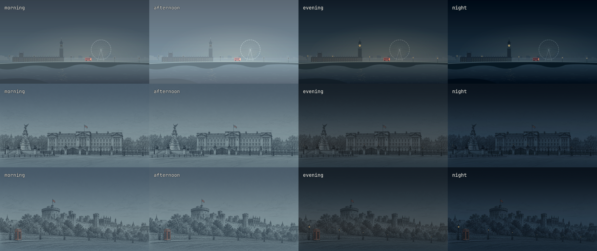
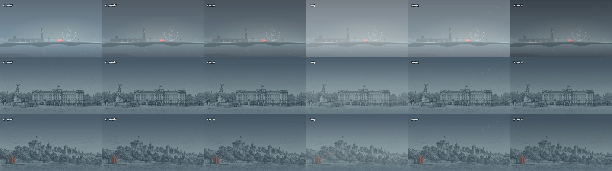
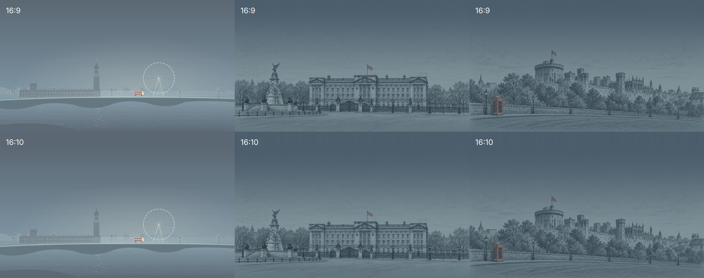
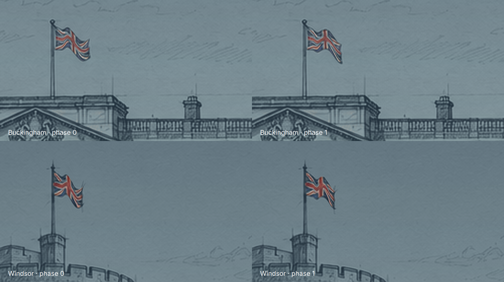

# London Motion

Animated 6K wallpapers with local-time lighting and optional live weather for the [London Omarchy theme](https://github.com/clear-built-dev/omarchy-london-theme).




- A red bus crosses Westminster Bridge in 110 seconds.
- The London Eye rotates once every 220 seconds; its supports remain fixed.
- Big Ben's hands show local system time, updating on each minute change.
- The Buckingham Palace and Windsor Castle flags ripple gently on a 4.4-second loop.
- Morning, afternoon, evening and night lighting blends gradually through the day.
- Optional real weather adds clear/cloudy lighting, rain, fog, snow or subdued storm conditions.

The comparison image above shows the four lighting treatments; automatic
lighting blends gradually through the day. Big Ben's clock always shows actual local time.

The theme's saved PNGs already use the slate palette, so carousel thumbnails and
static fallbacks match. Uncoloured 6K drawing bases live in this plugin's assets
for dynamic rendering; the palette is applied once. The backgrounds remain still PNGs. The plugin draws the moving parts locally
at 20 frames per second, with no video playback. Motion and time-of-day lighting
work offline; optional live weather uses a bounded request to wttr.in every 15 minutes. It animates only the London theme's three named backgrounds.

## Requirements

- **Omarchy Quattro**, tested on **4.0.6-1**, including its Quickshell background
  service and support for `omarchy.clonedFrom` plugin replacements.
- The [London theme](https://github.com/clear-built-dev/omarchy-london-theme),
  the matching **6K architectural pen-and-pencil edition**, installed under the slug **`london`**, with its
  original filenames and current palace/castle compositions. Flag animation
  coordinates match the architectural pen-and-pencil artwork. Older art editions
  use different positions. Renamed themes and changed flag positions are not supported.
- Qt Quick, Qt Quick Effects and Quickshell supplied by Omarchy. `curl`, already
  shipped with Omarchy, is used only when weather is configured.

Other Omarchy versions have not been verified. This service contains a modified
copy of the 4.0.6 background renderer; changes in future Omarchy versions may
require an update. It replaces the built-in background service while enabled,
including when another theme is selected. Other themes retain still wallpapers.

## Install

First install the theme:

```sh
omarchy theme install https://github.com/clear-built-dev/omarchy-london-theme
```

Then add the plugin. Review it before enabling:

```sh
omarchy plugin add https://github.com/clear-built-dev/omarchy-london-motion
omarchy plugin enable io.github.clear-built-dev.london-motion --section center --after omarchy.clock
omarchy restart shell
```

Enabling explicitly replaces `omarchy.background`; restarting ensures cached
QML components are refreshed. The plugin does not install packages or modify
terminal settings, Hyprland configuration, theme files, or global font settings.
Omarchy records the enabled plugin in its normal user shell configuration.

If another wallpaper-renderer clone is enabled, switch back to
`omarchy.background` before enabling London Motion. Your old clone stays on disk.

Cycle through the three backgrounds with `omarchy theme bg next`.

## Current desktop controls

A wallpaper icon appears immediately to the right of the clock. Click it to open
**London Wallpaper** controls for background selection, scene motion, time-of-day lighting, fixed light
presets, live weather, city and weather previews. The icon remains available when
individual features are off.

Motion, lighting, lighting mode, weather on/off and the city persist across shell
restarts in `~/.config/omarchy/london-motion.json`. Live weather defaults to off.
Saving a city does not enable weather; its switch is a separate explicit action.
The system-time clock continues updating when scene motion is paused.

The main plugin can still be enabled/disabled under **Super + Alt + Space → Setup →
Plugins**. Temporary preview commands below do not overwrite saved preferences.
A panel opened from the terminal uses:

```sh
omarchy-shell io.github.clear-built-dev.london-motion.controls open
```

## Time of day

Automatic lighting follows the **sun's position for the configured weather
city** once that city's coordinates have been received. This accounts for
seasonal daylight and twilight; the calculation uses UTC and does not assume
that the city and computer share a time zone. It does not perform an extra
location lookup. Fixed presets remain available from the control panel.

If no city coordinates are available, lighting falls back to these local-time
periods:

| Local time | Appearance |
| --- | --- |
| 22:00–05:00 | Night |
| 05:00–07:00 | Night gradually becomes morning |
| 07:00–11:00 | Morning |
| 11:00–13:00 | Morning gradually becomes afternoon |
| 13:00–16:00 | Afternoon |
| 16:00–18:00 | Afternoon gradually becomes evening |
| 18:00–20:00 | Evening |
| 20:00–22:00 | Evening gradually becomes night |

The appearance is recalculated from the system clock each minute, including
after sleep or clock changes. The period table above is the offline fallback;
solar lighting uses approximate NOAA solar-position equations for the known city. Only the wallpaper changes; terminal and application colours stay the
same. All moving parts receive the same lighting treatment. London retains daylight suppression of its baked-in amber lights. The palace
and castle drawings start with unlit lamps and use a slate-blue palette matching the London scene, with atmospheric gradients
and subtle colour shifts for daylight, dusk and night. At night, precise lantern masks add
restrained warm highlights while preserving ink frames. Windows remain dark.
These are stylized illustrations rather than photographic reconstructions.

Preview a look without changing the clock, then restore automatic lighting:

```sh
omarchy-shell background previewTimeOfDay afternoon
omarchy-shell background previewTimeOfDay automatic
```

Temporary IPC lighting previews ease over 1.2 seconds and reset on shell restart.
Fixed lighting selected in the panel is saved. Automatic changes ease over one minute.

## Optional live weather



Weather is **disabled until an explicit city or coordinates are configured**.
It never infers your location from your IP address. It first uses the city saved in the controls panel, then
`~/.config/omarchy/london-motion-weather.json`; if absent, it uses an explicitly
saved Omarchy weather location in `~/.local/state/omarchy/settings/weather.json`.
It does not change Omarchy's global weather settings.

The controls panel is the preferred way to set a city and enable live weather.
For compatibility, an explicit fallback city may also be configured by creating
`~/.config/omarchy/london-motion-weather.json` containing:

```json
{"name": "London, UK"}
```

A location with explicit `latitude` and `longitude` is also supported. An empty
or malformed configuration does not trigger a request. When configured, the
plugin sends that location to **wttr.in**, the same service used by Omarchy's
weather tools. Requests time out after 10 seconds and run at most once every
15 minutes per shell instance, shared across monitors. It does not write weather
responses to disk. The provider may supply delayed observations.

Clear, cloudy, rain, fog, snow and storm codes change the lighting. Rain and snow
add sparse native moving particles; storms darken the scene without flashing.
Failed fetches keep the last successful response for at most an hour, then fall
back to time-of-day lighting. Unknown or malformed conditions also fall back.
Weather changes fade gently. No network is needed for the rest of the plugin.

Preview weather without a network request, or suppress live weather:

```sh
omarchy-shell background previewWeather rain
omarchy-shell background previewWeather off
omarchy-shell background previewWeather automatic
```

Preview/off settings reset on shell restart. Remove the wallpaper weather config
and any explicit global Omarchy weather location, or simply turn off **Live weather**
in the panel to disable fetching persistently.
Provider reference: https://github.com/chubin/wttr.in#json-output

## Disable or remove

Return to Omarchy's built-in still wallpaper renderer:

```sh
omarchy plugin enable omarchy.background
omarchy restart shell
```

Then, optionally remove the plugin:

```sh
omarchy plugin remove io.github.clear-built-dev.london-motion
```

The London theme and its wallpapers remain installed. To return to a different
previous wallpaper clone, explicitly enable that clone instead.

## Troubleshooting and behavior

```sh
omarchy plugin validate ~/.config/omarchy/plugins/io.github.clear-built-dev.london-motion
omarchy-shell background motionStatus
```

The status reports the selected theme, background, advancing animation clock, lighting period and weather freshness.
Allow a moment after shell startup for the background to load. If a background
does not move, confirm the theme slug is `london` and restart the shell.

Motion pauses while its component is hidden during a transition or another theme
is active. There is no dedicated battery, lock-state, or reduced-motion policy;
disable the plugin with the command above when you want still wallpapers.
Resource use depends on monitor count, resolution, and graphics driver; no
battery-life or performance benchmark is claimed.

The existing background picker, click handling and transitions are retained.
Animated scenes preserve the full landscape width on taller displays, extending
the already-lit sky into the extra height. This keeps the scene in frame on both
16:9 external monitors and 16:10 laptop panels without stretching the artwork.

 The plugin uses the same installed Omarchy
theme/background selector commands and reads the current theme/background state.
It does not download assets or execute repository-provided setup scripts. Configured
weather performs the documented HTTPS request, without running provider content.

## Development and license

`LondonMotion.qml` implements the animation. `Background.qml` is derived from
Omarchy's background renderer. The editable SVG motion assets are in `assets/`.
The development rendering/validation tools are kept outside this release package.
Flag cloth displacement shares the full-scene texture lookup with the wallpaper;
poles remain stationary and there is no separately sampled patch at the attachment.



MIT license, retaining David Heinemeier Hansson's upstream copyright and the
copyright for London additions. See [LICENSE](LICENSE) and [NOTICE.md](NOTICE.md).

## Lighting shader

`SceneLighting.frag` implements the single-pass lighting treatment. Its compiled
Qt shader is included as `SceneLighting.frag.qsb`; normal use does not require a
shader compiler. To rebuild after editing (Qt Shader Tools):

```sh
/usr/lib/qt6/bin/qsb --glsl '100es,120,150' --hlsl 50 --msl 12 -o SceneLighting.frag.qsb SceneLighting.frag
```

Solar position reference: https://gml.noaa.gov/grad/solcalc/solareqns.PDF
